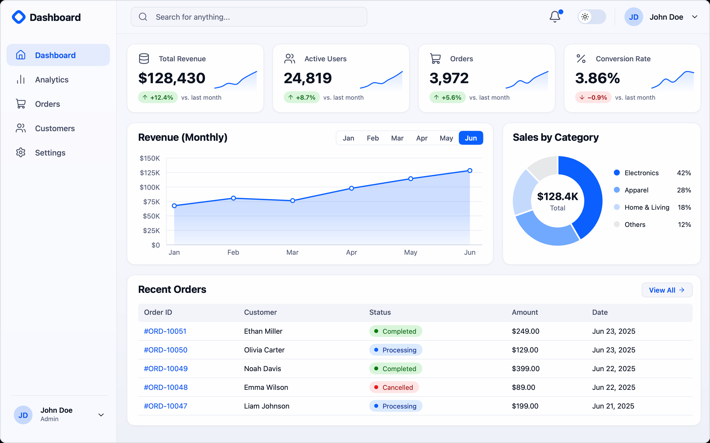
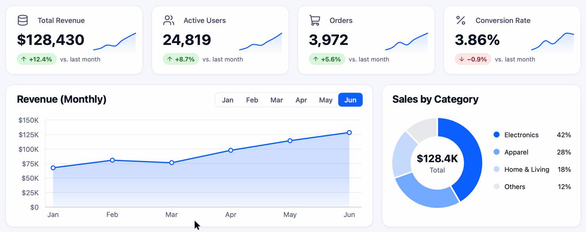

<div align="center">

# mygo-master

An agent skill for building Go desktop apps with MyGo, and the sample dashboard its standards came from

[한국어](README.md) · English

</div>

## Let your agent install it

Paste the text below into a coding agent such as Claude Code.

```text
Install the mygo-master skill from https://github.com/yldst-dev/mygo-master.

1. Clone the repository into a temporary folder with git clone --depth 1.
2. Copy its skills/mygo-master folder into my personal skills folder under the name mygo-master. For Claude Code that is ~/.claude/skills/mygo-master. For another agent, find the folder it loads skills from.
3. If a folder with that name already exists, ask me before removing it.
4. Check that the front matter of SKILL.md in the copied folder contains name: mygo-master.
5. Delete the temporary folder and tell me where the skill was installed.
```

In Claude Code, start a new session and call it with `/mygo-master`. Its description mentions MyGo, so agents may also load it on their own when you hand them MyGo work. To install it by hand, see [Install by hand](#install-by-hand).

<picture>
  <source media="(prefers-color-scheme: dark)" srcset="docs/dashboard-dark.png">
  
</picture>

## What is in this repository

| Path | Contents |
|---|---|
| [`skills/mygo-master`](skills/mygo-master) | The skill: work order and checklist, 5 reference documents, a clean architecture starter, check scripts |
| [`dashboard`](dashboard) | The sample dashboard app the skill's motion values and recipes came from |
| [`docs`](docs) | Images for this page |

[MyGo](https://github.com/egoist/mygo) is a framework for desktop apps in Go. With its `ui` package it draws the interface itself, without a web view. This skill tells an agent how to handle versions, structure, motion and verification when it builds or changes a MyGo app.

The skill's documents are written in Korean. Agents read them without trouble; this page exists in both languages for people.

## The five standards

- **Latest MyGo.** Check the latest release before starting and confirm APIs against that version's source and docs. Upgrade a project that lags behind before changing features. Leave the version alone when it is pinned on purpose or when `go.mod` has a `replace`.
- **Clean architecture.** New apps are split into four layers, `domain`, `usecase`, `adapter` and `view`, and a test fails when a dependency points the wrong way. Existing apps keep their own structure.
- **Smooth.** Things react as soon as the pointer arrives and carry on without a jump when it changes direction. Once motion ends, the app stops asking for frames.
- **Precise.** The resting screen matches to the pixel, and values such as tooltips stay inside the chart.
- **Thorough.** Whatever works with a pointer also works with a keyboard. Tests are checked by breaking the code on purpose, and checks that were not run are never reported as done.

## Motion

<picture>
  <source media="(prefers-color-scheme: dark)" srcset="docs/motion-dark.gif">
  
</picture>

Frames were captured with `ui.Tester`, advancing time 20ms at a time, and put together at 50fps. The pointer is drawn on top of the frames.

The values in the skill were set while building the dashboard and kept after using it and finding it smooth enough.

| Use | Value | Name |
|---|---|---|
| Press | 100ms | `pressMotion` |
| Hover color, tooltip figures | 120ms | `fadeMotion` |
| Quick change, dot exit | 150ms | `quickMotion`, `dotExit` |
| Page enter | 180ms, from 6px below, from opacity 0.35 | `pageEnter` |
| Chart marks, tooltip size | 180ms spring | `markSpring` |
| Theme change | 200ms | `themeMotion` |
| Sliding pill, rolling figures, list rows | 240ms spring | `pillMotion` |

A spring leaves a short tail after its set duration. Moving 220px with the 240ms spring, the last pixel changed at 336ms and frame requests stopped at 584ms.

## Run the sample dashboard

You need Go. `go.mod` asks for Go 1.27.3; with the default `GOTOOLCHAIN=auto`, an older Go downloads that version for you.

```sh
cd dashboard
go tool mygo dev
```

`go tool mygo dev` rebuilds and restarts the app when a Go file changes. Run the tests and build the app like this; the build lands in `build/darwin-arm64/Dashboard.app`.

```sh
go test ./...
go tool mygo build -skip-dmg
```

The dashboard was built before the clean architecture rule went into the skill, so it is a single package. For the structure of a new app, see the [starter](skills/mygo-master/assets/starter). Orders and customers on screen are made-up sample data.

## Install by hand

```sh
git clone --depth 1 https://github.com/yldst-dev/mygo-master.git
mkdir -p ~/.claude/skills
cp -R mygo-master/skills/mygo-master ~/.claude/skills/
```

If `~/.claude/skills/mygo-master` already exists, delete it first. Copying over it leaves old files behind.

## Check the skill

```sh
python3 skills/mygo-master/scripts/check_snippets.py
```

This compiles and tests the Go code in the documents against the latest MyGo, checks that every API name the documents mention exists in that version, and runs the new app script to the end. It downloads the latest MyGo, so it needs a network connection.

## What was checked

- Checked on macOS 27.2 with Go 1.27.3 and MyGo v0.7.4.
- Not run on Windows or Linux.
- Enter with a real Korean input method, web windows, `Timeline` and `Draggable` are written from source and docs only.

## Built with

- [MyGo](https://github.com/egoist/mygo), MIT License
- [Lucide](https://lucide.dev) icons, ISC License ([`dashboard/icons/LICENSE`](dashboard/icons/LICENSE))
