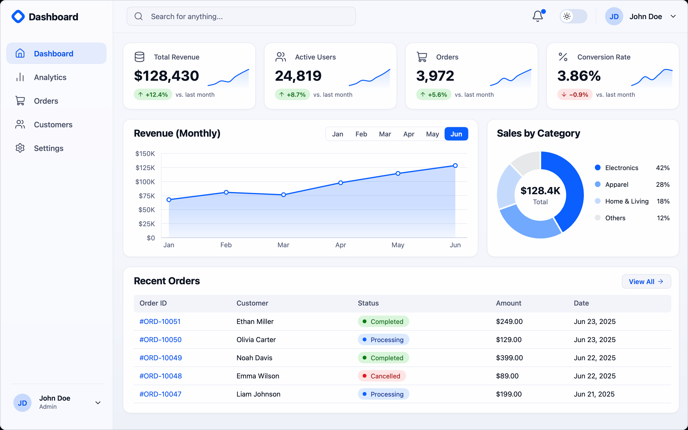
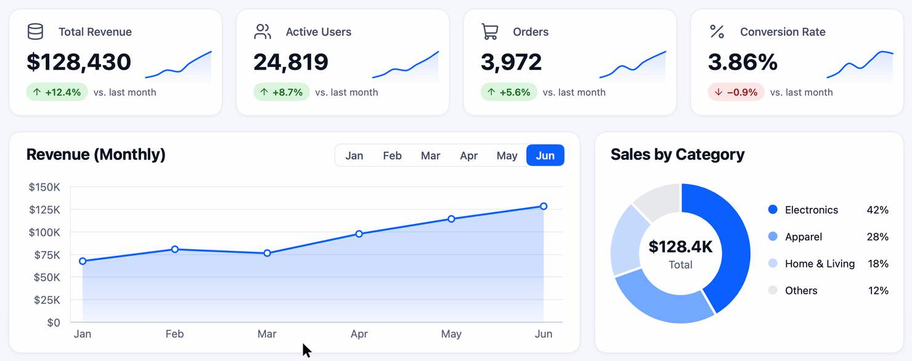

<div align="center">

# mygo-master

MyGo로 Go 데스크톱 앱을 만들 때 쓰는 에이전트 스킬과, 그 기준이 나온 예제 대시보드

한국어 · [English](README.en.md)

</div>

## 에이전트에게 설치 맡기기

아래 글을 Claude Code 같은 코딩 에이전트에게 그대로 붙여 넣으십시오.

```text
https://github.com/yldst-dev/mygo-master 저장소에 있는 mygo-master 스킬을 설치해 주세요.

1. 저장소를 임시 폴더에 git clone --depth 1 로 받아 주세요.
2. 저장소의 skills/mygo-master 폴더를 개인 스킬 폴더에 mygo-master라는 이름으로 복사해 주세요. Claude Code라면 ~/.claude/skills/mygo-master 입니다. 다른 에이전트라면 그 에이전트가 스킬을 읽는 폴더를 확인해서 넣어 주세요.
3. 같은 이름의 폴더가 이미 있으면 지우기 전에 먼저 물어봐 주세요.
4. 복사한 폴더의 SKILL.md 머리말에 name: mygo-master 가 있는지 확인해 주세요.
5. 임시 폴더를 지우고, 설치한 경로를 알려 주세요.
```

Claude Code에서는 새 세션에서 `/mygo-master` 로 부를 수 있습니다. 설명에 MyGo 관련 표현이 들어 있어서, MyGo 작업을 맡기면 에이전트가 스스로 불러 쓰기도 합니다. 손으로 설치하려면 [직접 설치하기](#직접-설치하기)를 보십시오.

<picture>
  <source media="(prefers-color-scheme: dark)" srcset="docs/dashboard-dark.png">
  
</picture>

## 이 저장소에 있는 것

| 경로 | 내용 |
|---|---|
| [`skills/mygo-master`](skills/mygo-master) | 스킬 본체. 작업 순서와 점검표, 참고 문서 5개, 클린 아키텍처 시작 템플릿, 점검 스크립트 |
| [`dashboard`](dashboard) | 스킬의 모션 값과 레시피가 나온 예제 대시보드 앱 |
| [`docs`](docs) | 이 문서의 이미지 |

[MyGo](https://github.com/egoist/mygo)는 Go로 데스크톱 앱을 만드는 프레임워크로, `ui` 패키지를 쓰면 웹뷰 없이 화면을 직접 그립니다. 이 스킬은 에이전트가 MyGo 앱을 만들거나 고칠 때 버전, 구조, 움직임, 검증을 어떤 기준으로 다룰지 정해 줍니다.

## 스킬이 지키는 다섯 가지

- **최신 MyGo로 짭니다.** 작업을 시작할 때 최신 릴리스를 확인하고, 그 버전의 소스와 문서로 API를 확인합니다. 뒤처진 앱은 기능을 고치기 전에 먼저 올립니다. 버전을 고정해 두었거나 `replace` 가 있으면 건드리지 않습니다.
- **클린 아키텍처로 짭니다.** 새 앱은 `domain`, `usecase`, `adapter`, `view` 네 층으로 나누고, 의존 방향을 어기면 테스트가 실패합니다. 기존 앱은 그 앱의 구조를 따릅니다.
- **부드럽습니다.** 커서가 닿으면 바로 반응하고, 중간에 방향이 바뀌어도 끊기지 않고 이어집니다. 움직임이 끝나면 프레임 요청도 멈춥니다.
- **정확합니다.** 쉬는 화면은 픽셀까지 맞추고, 말풍선 같은 값은 그래프 경계 안에 둡니다.
- **꼼꼼합니다.** 포인터로 되는 일은 키보드로도 되게 합니다. 테스트는 코드를 일부러 망가뜨려 정말 잡아내는지 확인하고, 돌리지 않은 검증은 돌렸다고 말하지 않습니다.

## 움직임

<picture>
  <source media="(prefers-color-scheme: dark)" srcset="docs/motion-dark.gif">
  
</picture>

`ui.Tester` 로 시간을 20ms씩 진행하며 찍은 프레임을 50fps로 묶었습니다. 포인터는 프레임 위에 덧그렸습니다.

스킬에 들어 있는 값은 대시보드를 만들며 정하고, 직접 써 본 뒤 충분히 부드럽다고 판단한 것입니다.

| 쓰임 | 값 | 이름 |
|---|---|---|
| 누름 | 100ms | `pressMotion` |
| 호버 색, 말풍선 숫자 | 120ms | `fadeMotion` |
| 빠른 전환, 점 사라짐 | 150ms | `quickMotion`, `dotExit` |
| 페이지 들어오기 | 180ms, 6px 아래에서, 불투명도 0.35에서 | `pageEnter` |
| 그래프 표식, 말풍선 크기 | 스프링 180ms | `markSpring` |
| 테마 전환 | 200ms | `themeMotion` |
| 알약 이동, 숫자 굴림, 목록 행 | 스프링 240ms | `pillMotion` |

스프링은 지정 시간 뒤에도 꼬리가 조금 남습니다. 240ms 스프링으로 220px을 움직이면 마지막 픽셀 변화는 336ms에, 프레임 요청은 584ms에 멈췄습니다.

## 예제 대시보드 실행하기

Go가 필요합니다. `go.mod` 는 Go 1.27.3을 요구하며, 설치된 Go가 더 낮아도 기본 설정(`GOTOOLCHAIN=auto`)이면 Go가 그 버전을 내려받습니다.

```sh
cd dashboard
go tool mygo dev
```

`go tool mygo dev` 는 Go 파일을 고치면 다시 빌드하고 재시작합니다. 테스트와 앱 빌드는 아래처럼 돌립니다. 빌드 결과는 `build/darwin-arm64/Dashboard.app` 에 생깁니다.

```sh
go test ./...
go tool mygo build -skip-dmg
```

대시보드는 클린 아키텍처 규칙을 스킬에 넣기 전에 만든 앱이라 패키지 하나로 되어 있습니다. 새 앱의 구조는 [시작 템플릿](skills/mygo-master/assets/starter)을 보십시오. 화면의 주문과 고객은 지어낸 예제 데이터입니다.

## 직접 설치하기

```sh
git clone --depth 1 https://github.com/yldst-dev/mygo-master.git
mkdir -p ~/.claude/skills
cp -R mygo-master/skills/mygo-master ~/.claude/skills/
```

`~/.claude/skills/mygo-master` 가 이미 있으면 먼저 지우고 복사하십시오. 덮어 복사하면 예전 파일이 남습니다.

## 스킬 점검하기

```sh
python3 skills/mygo-master/scripts/check_snippets.py
```

문서 속 Go 코드를 최신 MyGo로 컴파일하고 테스트를 돌립니다. 문서에 적힌 API 이름이 그 버전에 있는지, 새 앱 스크립트가 끝까지 도는지도 확인합니다. 최신 MyGo를 내려받으므로 네트워크가 필요합니다.

## 확인한 범위

- macOS 27.2, Go 1.27.3, MyGo v0.7.4에서 확인했습니다.
- Windows와 Linux에서는 돌려 보지 않았습니다.
- 실제 한글 입력기의 Enter 동작, 웹 창, `Timeline`, `Draggable` 은 소스와 문서 기준으로만 적었습니다.
- 스킬 문서는 한국어로 쓰여 있습니다.

## 사용한 것

- [MyGo](https://github.com/egoist/mygo), MIT 라이선스
- [Lucide](https://lucide.dev) 아이콘, ISC 라이선스([`dashboard/icons/LICENSE`](dashboard/icons/LICENSE))
